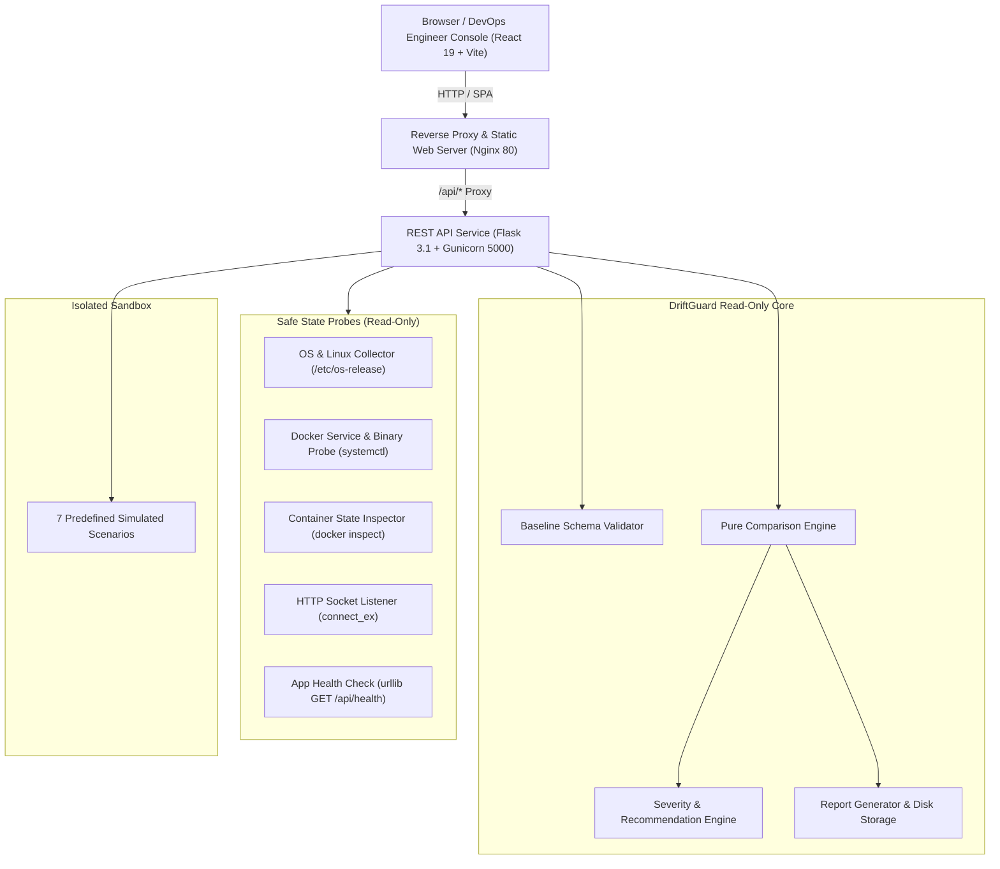

# DriftGuard — Infrastructure Configuration Drift Detection Platform

> **DevOps Hackathon Platform**  
> A functional, read-only infrastructure configuration drift detection and discrepancy audit engine built with React and Flask.

---

## 1. Problem Statement

Infrastructure configuration drift occurs when runtime host environments deviate from declared, approved baselines due to emergency manual hotfixes, untracked script executions, uncoordinated package installations, or malicious modifications. Undetected drift leads to silent production outages, security vulnerabilities, and deployment failures.

**DriftGuard** solves this challenge by continuously comparing declared infrastructure configurations against actual observed host metrics. It:
1. Identifies discrepancies deterministically.
2. Explains their operational impact and assigns risk severities (**CRITICAL**, **HIGH**, **MEDIUM**, **LOW**, **INFO**).
3. Generates human-actionable corrective guidance.
4. Produces downloadable audit-grade JSON reports.
5. **Never automatically modifies, repairs, or restarts infrastructure.** All diagnostic actions remain strictly read-only.

---

## 2. System Architecture



### Architectural Highlights
- **Strict Read-Only Enforcement:** No automated remediation or system reboots.
- **Isolated Simulated Sandbox:** Test matching states, port drifts, missing keys, and service outages without modifying any host or cloud resources.
- **Predefined Commands Only:** Prohibits `shell=True`, concatenations, and arbitrary shell input. Subprocess timeouts (2.0s - 3.0s) prevent hung processes.
- **Non-Root Execution:** Flask runs under unprivileged `appuser` (UID 10001).

---

## 3. Technology Stack

- **Frontend:** React 19, Vite 6, JavaScript, React Router 7, Recharts 2.15, Lucide React, Fetch API, Vanilla CSS Design System.
- **Backend:** Python 3.13, Flask 3.1, Flask-CORS 6.0, Gunicorn 23.0, Pytest 9.1.
- **Infrastructure & Containerization:** Docker, Docker Compose, Nginx Alpine, Ubuntu Linux, AWS EC2.

---

## 4. Repository Structure

```
drift/
├── backend/
│   ├── app.py                      # Flask Application Factory & Entrypoint
│   ├── config.py                   # App Configuration & Environment Allowlist
│   ├── routes/
│   │   ├── health.py               # GET /api/health
│   │   ├── baseline.py             # Baseline CRUD & Schema Rules
│   │   ├── drift.py                # POST /api/drift/check & GET /api/drift/latest
│   │   ├── reports.py              # Downloadable JSON Reports & Archive
│   │   └── scenarios.py            # Simulated Demonstration Scenarios
│   ├── services/
│   │   ├── comparison_engine.py    # Pure deterministic comparison engine
│   │   ├── state_collector.py      # Real host collector coordinator
│   │   ├── scenarios_service.py    # In-memory simulated test scenarios
│   │   ├── recommendation_engine.py# Severity and actionable guidance
│   │   ├── report_generator.py     # JSON report generation & disk persistence
│   │   └── baseline_service.py     # Baseline storage & validation
│   ├── collectors/
│   │   ├── linux_collector.py      # OS release & platform inspection
│   │   ├── docker_collector.py     # Binary presence, systemd, container state
│   │   └── http_collector.py       # Socket listener & localhost health check
│   ├── schemas/
│   │   └── baseline_schema.py      # JSON schema validation & port range rules
│   ├── tests/
│   │   ├── test_comparison_engine.py# Comparison logic & deterministic outcomes
│   │   ├── test_baseline_schema.py # Schema validation & invalid types
│   │   ├── test_state_collector.py # Probes & simulated fixtures isolation
│   │   ├── test_reports.py         # Report generation & persistence
│   │   └── test_api.py             # Flask test client endpoint integration
│   ├── requirements.txt            # Python dependencies
│   ├── Dockerfile                  # Secure unprivileged Python container
│   └── .dockerignore
├── frontend/
│   ├── src/
│   │   ├── components/
│   │   │   ├── Sidebar.jsx         # Persistent cloud console navigation
│   │   │   ├── Header.jsx          # Environment selector & mode indicator
│   │   │   ├── MetricCard.jsx      # Reusable dashboard metric card
│   │   │   ├── StatusBadge.jsx     # Status & severity badges
│   │   │   ├── DriftTable.jsx      # Filterable findings table
│   │   │   ├── RecommendationPanel.jsx # Discrepancy diagnosis & diff modal
│   │   │   ├── EmptyState.jsx      # Initial scan call-to-action
│   │   │   ├── LoadingState.jsx    # Scanning progress spinner
│   │   │   └── ErrorState.jsx      # Error handling banner
│   │   ├── pages/
│   │   │   ├── Dashboard.jsx       # Overview with Recharts metrics
│   │   │   ├── Infrastructure.jsx  # Monitored components & probes
│   │   │   ├── Baselines.jsx       # JSON editor & schema validation
│   │   │   ├── DriftDetection.jsx  # Filterable findings & checks
│   │   │   ├── Reports.jsx         # Downloadable JSON reports & history
│   │   │   ├── TestScenarios.jsx   # Interactive simulated sandbox
│   │   │   └── Settings.jsx        # Security policy & allowlist
│   │   ├── services/
│   │   │   └── api.js              # Centralized Fetch API client
│   │   ├── styles/
│   │   │   └── index.css           # Professional Cloud Operations Design System
│   │   ├── tests/
│   │   │   ├── components.test.jsx # Vitest & Testing Library UI tests
│   │   │   └── setup.js            # Jest-dom setup
│   │   ├── App.jsx                 # Routing and root state
│   │   └── main.jsx                # React DOM mount point
│   ├── nginx.conf                  # Nginx proxy & SPA configuration
│   ├── Dockerfile                  # Multi-stage production build
│   ├── vitest.config.js            # Vitest configuration
│   ├── vite.config.js              # Vite dev server & proxy
│   └── package.json
├── docker-compose.yml              # Multi-container orchestration
├── DEPLOYMENT.md                   # Complete AWS EC2 deployment guide
├── .env.example                    # Environment variable template
├── .gitignore
└── README.md
```

---

## 5. Local Setup & Quickstart

### Prerequisites
- Python 3.11+
- Node.js 18+ and npm
- Docker and Docker Compose (optional for local container testing)

### Step 1: Clone Repository
```bash
git clone https://github.com/your-username/driftguard.git
cd driftguard
```

### Step 2: Start Backend (Terminal 1)
```bash
# Setup Python virtual environment
python -m venv venv
# Windows:
.\venv\Scripts\activate
# Linux/macOS:
source venv/bin/activate

# Install dependencies
pip install -r backend/requirements.txt

# Run Flask backend on port 5000
python backend/app.py
```

### Step 3: Start Frontend (Terminal 2)
```bash
cd frontend
npm install
npm run dev
```

Open your browser to:
`http://localhost:3000`

---

## 6. Running Automated Tests

### Backend Test Suite (Pytest)
Runs 35 unit and integration tests covering comparison logic, invalid port ranges, schema validation, probe safety, simulated fixtures, and API endpoints:

```bash
# From repository root:
# Windows PowerShell:
$env:PYTHONPATH="backend"; python -m pytest backend/tests -v

# Linux/macOS:
PYTHONPATH=backend pytest backend/tests -v
```

### Frontend Test Suite (Vitest)
Runs UI component tests verifying loading states, error states, empty states, badge renderings, and table filtering:

```bash
cd frontend
npm test
```

---

## 7. Docker Compose Orchestration

Launch the full production stack locally with Docker Compose:

```bash
# Build and start services
docker compose up -d --build

# Inspect running containers
docker compose ps

# Check logs
docker compose logs -f
```

- Web Console: `http://localhost`
- Backend Health: `http://localhost:5000/api/health`
- Controlled Test Sandbox: `driftguard-test-container`

---

## 8. AWS EC2 Production Deployment

See the comprehensive [DEPLOYMENT.md](DEPLOYMENT.md) for step-by-step AWS provisioning:
1. Launch Ubuntu 24.04 EC2 instance (`t3.small` / `t3.micro`).
2. Attach Security Group permitting SSH (port 22 restricted to your IP) and HTTP (port 80).
3. Install Docker Engine and Docker Compose.
4. Clone repository and run `docker compose up -d --build`.
5. Access live via `http://<EC2_PUBLIC_IP>`.

---

## 9. Hackathon Demonstration Script (For Judges)

Follow these 4 live demonstration scenarios to verify every capability:

### DEMO 1: Run Check Against Matching Baseline
1. Open the **Overview** or **Test Scenarios** tab.
2. Select **Load Matching Demo** (or run scan with matching baseline).
3. **Observed Result:**
   - Overall status badge turns **COMPLIANT** (green).
   - Compliance rate displays **100%**.
   - Detected Drift count is **0**.
   - All findings report `MATCH` status with informational notes.

### DEMO 2: Port Drift Discrepancy & Actionable Recommendation
1. Navigate to **Test Scenarios** and click **Run Scenario** on **HTTP Port Drift (Port Changed to 8080)**.
2. Navigate to **Drift Detection**.
3. **Observed Result:**
   - Status updates to **DRIFT_DETECTED** with a **CRITICAL** severity badge on `http_port`.
   - Side-by-side comparison displays: Expected: `80`, Observed: `8080`.
   - Click **Inspect** to view diagnostic reasoning and recommended non-destructive operator steps:
     > *"Investigate why the configured HTTP port (8080) differs from the approved baseline (80). Check the web server / reverse proxy configuration (e.g. nginx.conf) and intended firewall policy before making changes."*
   - Explains that DriftGuard does not alter the port automatically.

### DEMO 3: Test Container State Drift Detection
1. In the controlled container environment or using the **Test Container Not Running** scenario:
   - For real environment: run `docker stop driftguard-test-container` on the host.
   - Click **Run Check**.
2. **Observed Result:**
   - DriftGuard detects that `test_container_running` changed from `true` to `false`.
   - Generates a **HIGH** severity finding recommending container log inspection without automatically restarting the container.

### DEMO 4: Download Audit-Grade JSON Drift Report
1. Click **Reports** in the sidebar.
2. Inspect the real-time machine-readable JSON preview.
3. Click **Download JSON Report**.
4. **Observed Result:**
   - A validated JSON audit artifact named `drift-report-<timestamp>.json` downloads immediately.
   - Contains `baseline_snapshot`, `observed_snapshot`, `summary`, and detailed `findings`.
   - History archive confirms persistent local disk retention.

---

## 10. Security Guardrails & Policy Summary

1. **Non-Destructive Guarantee:** DriftGuard strictly audits and advises; it never repairs or restarts infrastructure.
2. **Zero Shell Concatenation:** Predefined argument arrays with `shell=False`.
3. **Strict Subprocess Timeouts:** Prevents denial-of-service from unresponsive sockets or commands.
4. **Localhost Socket Probing:** Socket connect calls are strictly bound to `127.0.0.1` and validated port numbers (1 - 65535).
5. **Least Privilege Container:** Flask runs as non-root `appuser` (UID 10001).

---

## License
MIT License — DevOps Hackathon 2026.
